# AI-Based Image Retrieval System using OpenAI CLIP

An AI-powered semantic image retrieval system that understands natural language queries and returns contextually relevant images from several stock image platforms. The application integrates OpenAI's CLIP (Contrastive Language-Image Pre-training) model with Unsplash, Pexels, and Pixabay APIs to perform intelligent image retrieval beyond traditional keyword-based search.

The project is built using Python, Flask, Hugging Face Transformers, and PyTorch, demonstrating the practical application of multimodal AI for real-time image search.

---

## Project Overview

Traditional image search engines primarily depend on manually assigned keywords and metadata, which often fail to capture the actual meaning or context of a user's query. This project addresses that limitation by leveraging OpenAI's CLIP model, which maps both text and images into a shared semantic embedding space.

When a user enters a descriptive sentence, the application retrieves candidate images from multiple stock image providers, generates embeddings for both the query and the retrieved images using CLIP, computes cosine similarity scores, ranks the images according to semantic relevance, and displays the most appropriate results.

---

## Features

- Natural language-based image search
- Semantic image retrieval using OpenAI CLIP
- Real-time image retrieval from multiple stock image providers
- Integration with Unsplash, Pexels, and Pixabay APIs
- Image ranking using cosine similarity
- Flask-based web application
- Direct image source and download links
- Lightweight architecture without training a custom model

---

## Technology Stack

### Backend

- Python
- Flask

### Frontend

- HTML
- CSS
- JavaScript

### AI & Machine Learning

- OpenAI CLIP
- Hugging Face Transformers
- PyTorch

### APIs

- Unsplash API
- Pexels API
- Pixabay API

### Libraries

- Requests
- Pillow
- NumPy

---

## Project Workflow

The complete workflow of the image retrieval pipeline is illustrated below.

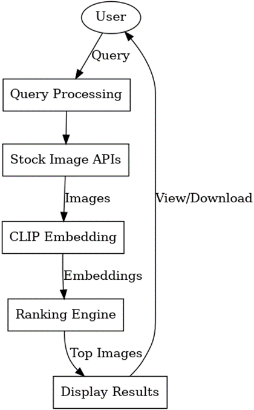

### Workflow Steps

1. The user enters a natural language query.
2. The Flask backend receives the request.
3. Relevant images are fetched from Unsplash, Pexels, and Pixabay.
4. CLIP generates embeddings for both the text query and retrieved images.
5. Cosine similarity is calculated between the text and image embeddings.
6. Images are ranked according to semantic similarity.
7. The highest-ranked images are displayed to the user.

---

## Application Screenshots

### Home Page

The application's landing page where users can enter descriptive search queries.

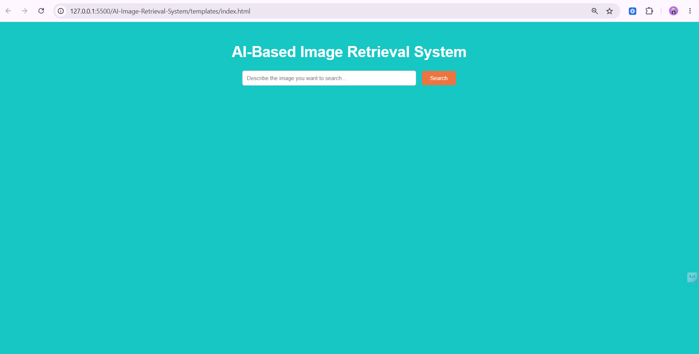

---

### Search Query

Example of a natural language prompt entered by the user.

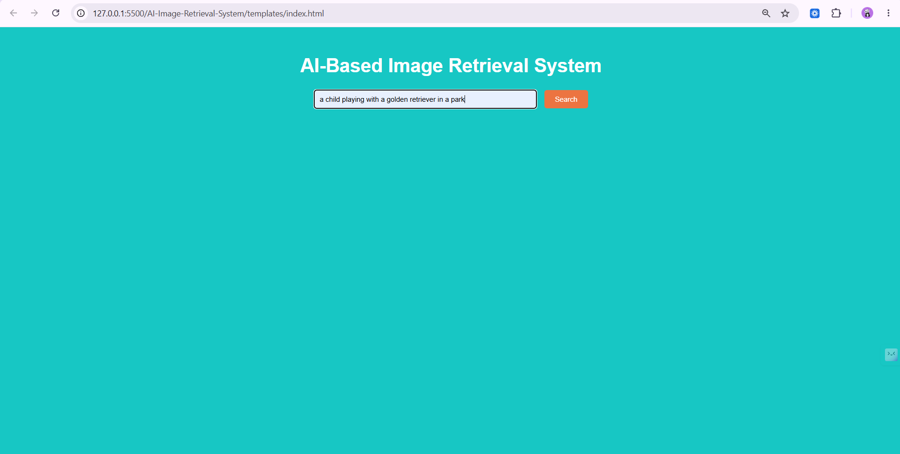

---

## Sample Retrieval Results

The following examples demonstrate the semantic retrieval capability of the system across different types of natural language prompts.

### Example 1 — Man Working at a Desk

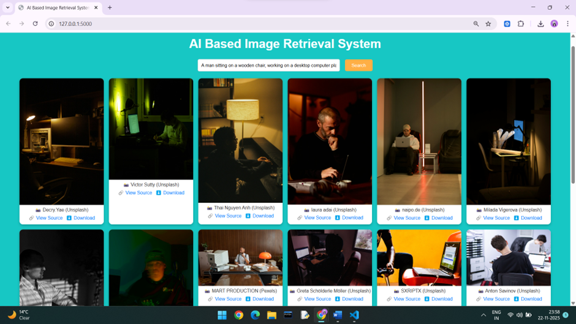

### Example 2 — Cyclist Riding Uphill Through Fog

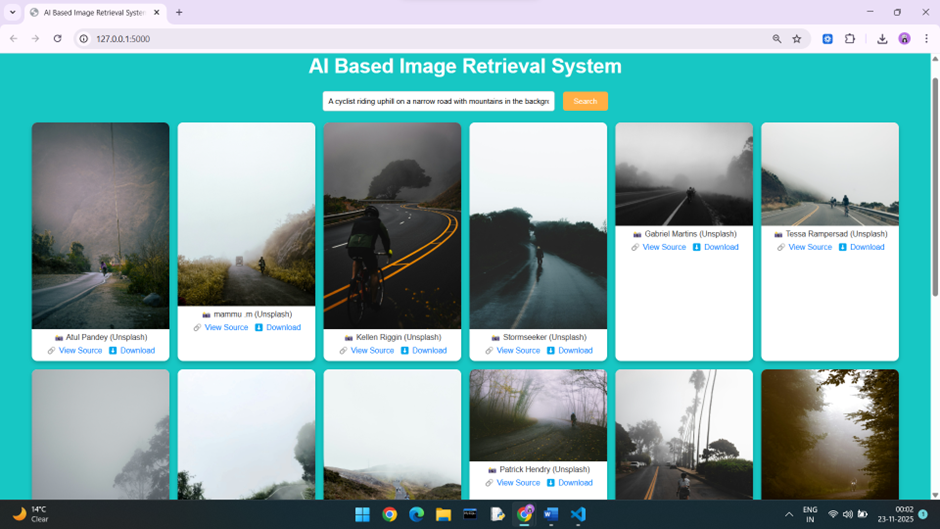

### Example 3 — Wildlife Photographer Kneeling

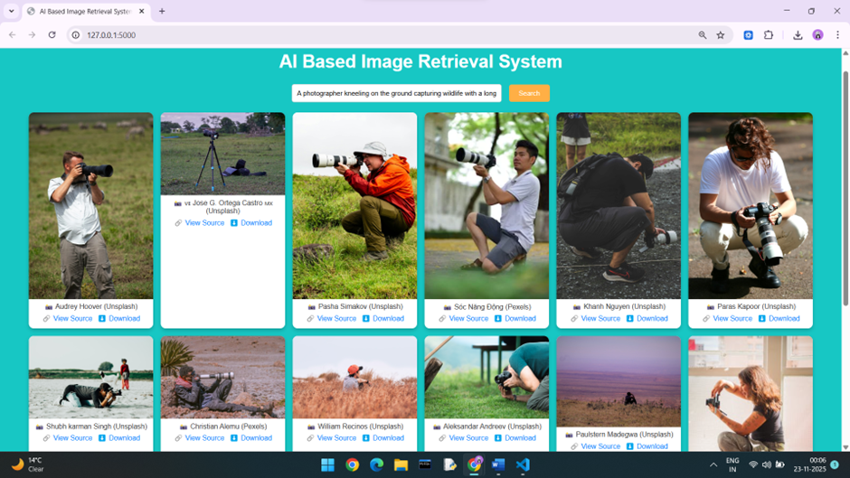

### Example 4 — Scientist Mixing Chemicals

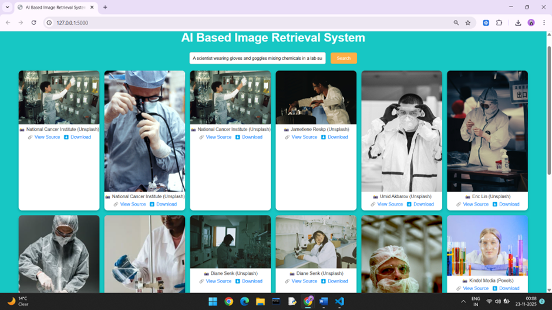

### Example 5 — Chef Flipping Vegetables

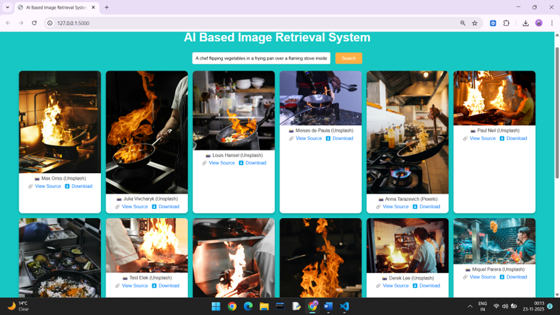

### Example 6 — Calm Sunset Over Mountains

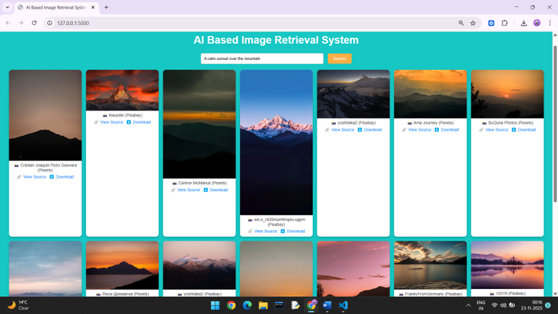

### Example 7 — Child Playing with a Golden Retriever

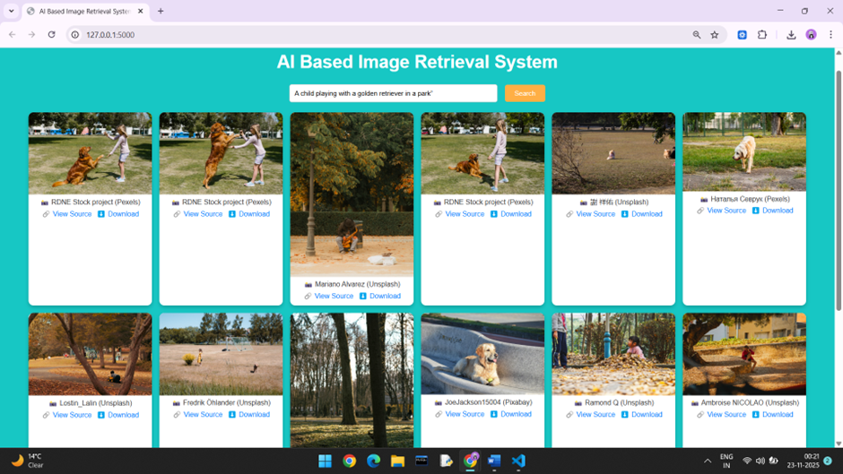

---

## Experimental Results

The retrieval system was evaluated using **Precision@15**, which measures the proportion of relevant images among the top 15 retrieved results for each query.

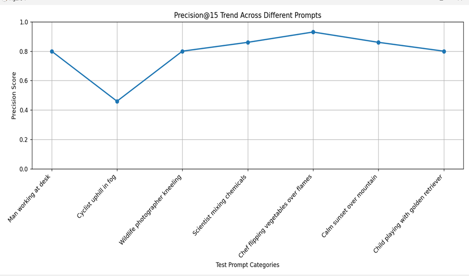

### Precision@15 Performance

| Test Prompt | Precision@15 |
|--------------|-------------:|
| Man working at desk | 0.80 |
| Cyclist uphill in fog | 0.46 |
| Wildlife photographer kneeling | 0.80 |
| Scientist mixing chemicals | 0.86 |
| Chef flipping vegetables | 0.93 |
| Calm sunset over mountain | 0.86 |
| Child playing with golden retriever | 0.80 |

### Key Observations

- The system performs well on visually distinctive scenes.
- Semantic understanding significantly improves retrieval quality compared to keyword-based search.
- Performance decreases for highly complex or multi-object scenes.
- OpenAI CLIP effectively supports zero-shot semantic image retrieval without task-specific training.

---

## Project Structure

```text
AI-Image-Retrieval-System/
│
├── app.py
├── README.md
├── requirements.txt
├── Procfile
├── runtime.txt
├── .gitignore
├── .env.example
│
├── templates/
│   └── index.html
│
└── screenshots/
    ├── home-page.png
    ├── search-query.png
    ├── workflow.png
    ├── precision-analysis.png
    ├── search-results_1.png
    ├── search-results_2.png
    ├── search-results_3.png
    ├── search-results_4.png
    ├── search-results_5.png
    ├── search-results_6.png
    └── search-results_7.png
```

---

## Installation

### Clone the Repository

```bash
git clone https://github.com/AnjaliiiMaurya/AI-Image-Retrieval-System.git
```

### Navigate to the Project Directory

```bash
cd AI-Image-Retrieval-System
```

### Create a Virtual Environment

```bash
python -m venv venv
```

### Activate the Virtual Environment

Windows

```bash
venv\Scripts\activate
```

Linux/macOS

```bash
source venv/bin/activate
```

### Install Dependencies

```bash
pip install -r requirements.txt
```

---

## Environment Variables

Create a `.env` file using `.env.example` and add the following API keys.

```env
UNSPLASH_ACCESS_KEY=your_unsplash_access_key
PEXELS_API_KEY=your_pexels_api_key
PIXABAY_API_KEY=your_pixabay_api_key
```

---

## Running the Application

Start the Flask server.

```bash
python app.py
```

Open your browser and navigate to:

```text
http://127.0.0.1:5000
```

---

## Future Improvements

- Support multilingual search queries
- Integrate additional stock image providers
- Improve ranking using larger vision-language models
- Implement embedding caching for faster retrieval
- Add image filtering and category-based search
- Improve mobile responsiveness
- Deploy as a scalable cloud application

---

## References

- OpenAI CLIP
- Hugging Face Transformers
- Flask Framework
- Unsplash Developers API
- Pexels API
- Pixabay API

---

## Author

**Anjali Maurya**

Master of Computer Applications (MCA)  
Indira Gandhi Delhi Technical University for Women (IGDTUW)

GitHub: https://github.com/AnjaliiiMaurya
